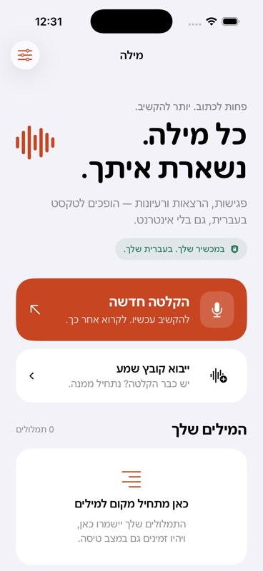

# מילה · Mila

A native Swift / SwiftUI iPhone and iPad app for Hebrew transcription, with the **entire model and inference runtime bundled in the app**. Hebrew interface, right-to-left navigation, and iOS 17+. No accounts, analytics, or transcription server.

מילה מתמללת פגישות, הרצאות והודעות קוליות בעברית — במכשיר שלכם, גם בלי אינטרנט.

[Support / תמיכה](SUPPORT.md) · [Privacy / פרטיות](PRIVACY.md) · [MIT license](LICENSE) · [Complete source and model downloads](https://github.com/buzagloidan/mila/releases/tag/v1.0.0-build.2)



## Open and run

Install Xcode with an iOS simulator runtime and select its command-line tools. Python 3.9+ is used for dependency setup. XcodeGen is only needed when regenerating the checked-in Xcode project.

```sh
git clone https://github.com/buzagloidan/mila.git
cd mila
python3 scripts/bootstrap.py
open HebrewVoice.xcodeproj
```

The setup script downloads pinned model files and native framework archives from this repository's GitHub release and verifies their SHA-256 checksums. This is a **developer setup step**; the installed iOS app never downloads its model.

1. Open `HebrewVoice.xcodeproj` in Xcode.
2. Choose the `HebrewVoice` scheme and an iPhone simulator, then Run.
3. For a physical iPhone or your own distribution, select your own Apple development team for both targets and unique bundle identifiers. Register an App Group you control, and update both `HebrewVoice/HebrewVoice.entitlements` and `Shared/SharedAudioStorage.swift`. See [INTEGRATIONS.md](INTEGRATIONS.md). The checked-in team/bundle identifiers describe the original app; no signing credentials are included.
4. To check recognition without using a microphone: **הגדרות ופרטיות → תמלול קטע הדוגמה הכלול**. The included recording should produce **שלום**.

No model download, API key, account, speech-recognition permission, or server is needed. Only recording requires microphone permission. Links and explicitly sharing/exporting content are user initiated.

## Included behavior

- Hebrew UI and forced right-to-left layout, including navigation, sheets, editing, search, and accessibility labels. Timers remain left-to-right.
- Live microphone transcription using the bundled quantized Zipformer2 model and sherpa-onnx C API, directly from Swift.
- Background/locked-screen microphone recording via an audio session and the audio background mode.
- Audio file import using the system Files picker. Apple-supported audio formats such as WAV, M4A, MP3, and CAF are decoded through AVAudioFile. Stereo is downmixed; sherpa-onnx resamples to 16 kHz.
- Local searchable library, editable titles/text, text sharing, UTF-8 TXT export, audio playback, and deletion with confirmation.
- Optional retained microphone audio as mono AAC/M4A (up to 64 kbps, about 29 MB/hour). Imported audio is copied unchanged only if retention is enabled.
- Five-second transcript checkpoints. Interrupted sessions remain visible as partial transcripts after relaunch. Interruptions and disconnected audio devices stop and save the session.
- Native audio-file opening from the system share sheet, with automatic local transcription, three Hebrew Shortcuts actions, and a recording Live Activity with a stop/save button. See `INTEGRATIONS.md` for setup and use.
- Streaming file reads and a bounded microphone inference queue. If inference falls over 20 seconds behind, recording stops with a visible error instead of accumulating unlimited audio in memory.
- Apple's native review prompt after repeated completed transcriptions, with local eligibility and a 90-day cooldown, plus a permanent Hebrew rating link in Settings.

## Architecture

`RecordingSession` owns the user-visible session state and AVAudioEngine. Audio callbacks only copy/downmix PCM and enqueue it. `TranscriptionWorker` serializes inference, file decoding, and audio writes off the main thread. `NativeRecognizer` owns C handles and C result lifetimes, finalizes phrases at endpoints, and flushes the last 1.28-second model chunk with 1.5 seconds of silence. `TranscriptStore` saves one atomic JSON file per session in Application Support, next to any retained audio.

`AppServices` is the shared app-process service graph for scenes and App Intents. A small observable navigation handoff opens the recorder or a saved transcript. `SharedAudioStorage` stages incoming documents atomically into a durable App Group queue, including compatibility with pending files from earlier builds. Selecting מילה for an audio document opens the main app and starts transcription; no Share Extension confirmation screen is shipped. `RecordingLiveActivity` owns ActivityKit lifecycle, with shared attributes and a LiveActivityIntent compiled into the app and widget extension.

Recording and playback share `AudioSessionController`, which serializes audio-session configuration and activation/deactivation on a dedicated background queue. The UI awaits completion without blocking its main thread; this also retains support for iOS 17 where the newer activation APIs are unavailable.

The model uses the CPU provider with two threads. It does not use Apple Speech or require an internet-backed recognition service. No punctuation model, summarizer, translation model, or speaker-diarization model is included.

## Reproducible dependencies

The Git repository contains the complete app source, tests, UI assets, licensed sample audio, notices, Xcode projects and listing assets. Large model/runtime binaries are hosted in [GitHub Releases](https://github.com/buzagloidan/mila/releases/tag/v1.0.0-build.2). A clean source checkout restores and verifies them with:

```sh
python3 scripts/bootstrap.py
```

For offline integrity verification after setup:

```sh
python3 scripts/bootstrap.py --verify-only
```

For an offline development setup, download `Mila-1.0-build-2-source-with-assets.zip` from the same release. It includes all source files, model files and native framework archives. Extract it, enter `mila/`, then run `python3 scripts/bootstrap.py`; existing local archives are unpacked and verified without network access. The release also contains the individual unchanged model/runtime files and `SHA256SUMS`.

To use the original upstream downloads instead of the release mirrors:

```sh
python3 scripts/bootstrap.py --upstream
```

`assets-lock.json` pins all four model files to HF revision `6c07526ebfdfc71d12ed4ce6aaebe32774a2613a`, sherpa-onnx **1.13.7**, and its matching ONNX Runtime **1.28.1** iOS static XCFrameworks. Archive SHA-256 values match the upstream Swift package manifests. The app bundle includes the model as ordinary resources; these are not on-demand resources.

If changing source files/targets or build settings, regenerate the checked-in project using XcodeGen:

```sh
xcodegen generate
```

XcodeGen is a development tool, not an app dependency. The generated `.xcodeproj` can be opened without it. Python 3.9+ is used only for dependency setup.

Run the tests with an installed simulator (substitute its name if different):

```sh
xcodebuild -project HebrewVoice.xcodeproj -scheme HebrewVoice \
  -destination 'platform=iOS Simulator,name=iPhone 17 Pro' \
  CODE_SIGNING_ALLOWED=NO test
```

The separate system share-sheet UI tests live in [Tools/DocumentProbe](Tools/DocumentProbe/README.md). See [CONTRIBUTING.md](CONTRIBUTING.md) for the contribution workflow.

## Verification and practical limits

See `TEST_RESULTS.md` for tested builds and cases. Simulator inference passed with real Hebrew audio, including repeated utterances, final-chunk flushing, and the AAC recording pipeline. A physical iPhone has not been tested. Before public release, measure an hour-long recording, battery/thermal behavior, locked-screen audio, calls/Bluetooth interruptions, low storage, and import cancellation on actual supported phones. Simulator speed is not a phone performance benchmark.

Imported-file processing is foreground work with a limited iOS background grace period. If that period expires, the app cancels the import and saves the partial transcript. Microphone recording has the audio background mode. Force-quitting the app stops capture; the latest checkpoint can be recovered, but audio after it may not have a matching transcript.

All session data is local and excluded from iCloud backup; deleting the app removes it. Audio and transcripts use iOS file protection accessible after the first device unlock, allowing ongoing recording while locked. Sharing/exporting creates a copy at the destination chosen by the user. See `PRIVACY.md`.

## Attribution

[Hebrew Zipformer2 model](https://huggingface.co/thewh1teagle/zipformer2-66m-streaming-he) by **thewh1teagle**, licensed **CC BY 4.0**, using the k2-fsa/icefall base and ivrit.ai training audio. Model files are included unchanged. Native [sherpa-onnx](https://github.com/k2-fsa/sherpa-onnx) is Apache-2.0; [ONNX Runtime](https://github.com/microsoft/onnxruntime) is MIT. The spoken sample is YaronSh / Lingua Libre, CC0-1.0. Full bundled notices and source details are under `HebrewVoice/Resources/Licenses` and accessible inside the app.

The model is optimized for Hebrew. English and number formatting have limitations; transcription can contain errors. This app does not automatically identify speakers or add punctuation.

Mila's original source is available under [MIT](LICENSE). The model, native dependencies and sample keep their own licenses; see [THIRD_PARTY_NOTICES.md](THIRD_PARTY_NOTICES.md).

## Review requests

The native StoreKit review request is eligible after viewing a completed, nonempty transcript and returning to the library (including closing the completed recorder/import screen). The existing library must contain at least three completed, nonempty transcriptions created on two different local calendar days. The request waits two seconds and is cancelled by navigation, recording/import work, app inactivity, search, or app presentations/errors. The app also checks for system presentations before requesting.

Only the last request attempt date and app version are stored in local UserDefaults. Requests are limited to once per app version with a 90-day cooldown; there is no analytics SDK or event upload. iOS decides whether to display its dialog and does not report whether a user rated. Settings includes an always-available App Store review link. TestFlight does not display the native review dialog; development builds can display it for testing.

## App Store submission

Version 1.0 (build 2), including the native review prompt and Hebrew Settings rating link, was resubmitted on 18 October 2026 and was waiting for Apple review when this source release was prepared. The app is free, with manual release after approval. The source release is available now; it does not imply App Store approval. Public listing assets are under [AppStore](AppStore/README.md). Signing credentials, private review contacts, operational receipts and signed distribution packages are excluded from this repository.
